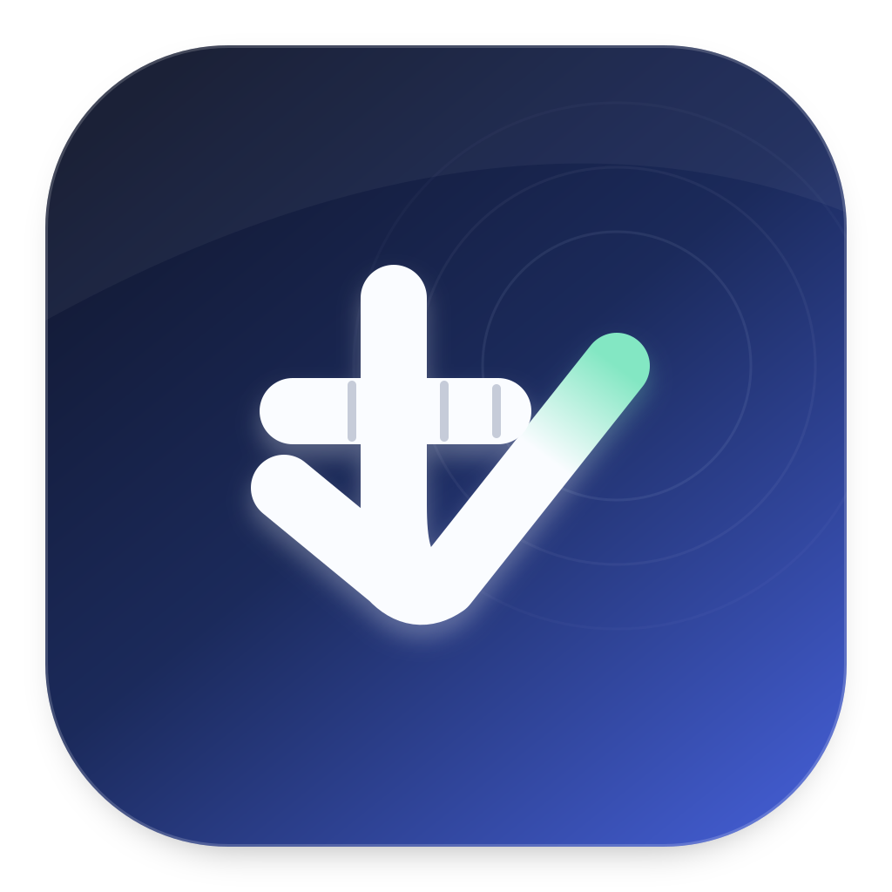

# Toccata

一个 macOS 本地任务与键盘活跃工作台。想到的事情先放进收集箱，回顾时一起整理期间完成和当前未完成的任务；键盘活动在工作台里显示为时间线。

名字取自「触键曲」（toccata，词根 toccare = 触碰）。

## 任务怎么用

- **想到就记**：在任务列表或菜单栏快速添加任务。新任务默认没有计划日期，也不会自动成为“今天必须完成”的任务；创建时间单独记录，计划日期可按需要设置。
- **按任务视图查看**：工作台侧栏统一进入“任务”，默认显示本周，可在页面内切换“本周 / 最近 7 天”。最近 7 天按创建时间筛选，本周汇集本周创建、之前遗留未完成和本周完成的任务；两个范围都保留符合条件的已完成任务。“收集箱”仍是独立入口，保留全部顶层任务。菜单栏继续使用“收集箱 / 最近 7 天 / 本周任务”三个范围，默认显示本周任务。
- **菜单栏直接编辑**：点击状态栏图标打开 312 × 554 pt 的白底紧凑任务列表，每项标题单行显示，不常驻显示创建时间副行，创建时间仍完整记录并用于视图筛选。子任务缩进显示在父任务下方，可折叠展开，已完成任务也保留层级。点击任务会在列表左侧打开独立的 400 × 300 pt 小浮窗，首次出现时轻快浮现，可编辑标题、Markdown 描述、计划日期及子任务，通过旗标设置优先级；原列表保持原有宽度并持续可见。选中任务后，按 Tab 定位到描述；选中顶层任务时，按 Enter 定位到添加子任务，子任务没有继续新增下级的入口；描述中的 Enter 仍然换行。右键或“更多操作”可删除任务，删除前会确认并说明子任务联动。
- **菜单栏快捷导航**：底部提供任务、日历、设置三个图标。日历在面板内展开月历，可翻月、回到今天并查看或编辑当天任务；设置菜单可打开工作台或退出应用。工作台仍提供完整任务详情。
- **用 Markdown 写详情**：每个任务可用 Markdown 整理背景、链接、列表和代码，在同一个可编辑区域中直接显示和修改排版，无需切换预览。详情统一保存为 Markdown 原文，子任务也有独立详情，但不能继续创建下级任务。历史过程数据继续保留在原有数据库表中，不再提供独立的过程记录入口。
- **保留完成记录**：菜单栏的完成状态显示为圆内对号，完成保存成功后播放一次系统提示音，恢复待办不播放。完成任务后仍可在收集箱的“已完成”区域查看、展开详情或恢复为待办。
- **在任务月历里查看**：可按创建、计划、完成或全部事件查看任务，选择日期后可查看、编辑当天任务。同一任务在一天内只列一次；没有计划日期的任务另列。常规新增仍不设置计划日期，只有明确选择按所选日期新建才会安排到当天。
- **一起回顾完成与待办**：“任务回顾”默认显示本周，可切换最近 7 天，分组展示所选期间完成的任务与当前全部未完成任务，包含子任务和之前遗留的待办。已完成部分依据实际 `completedAt` 筛选，创建日期和计划日期不影响归档；未完成部分不受创建日期限制。
- **准备周报素材**：可搜索任务名称与详情，并复制当前回顾为周报素材，包含完成与未完成分组、各组数量、任务详情和子任务的父级路径。自动按模板生成周报尚未实现。

日期范围按本机时区计算：“本周”从周一零点到当前时刻；“最近 7 天”从六天前零点到当前时刻，覆盖含今天的七个自然日。任务页面也会列出符合条件的子任务，较早创建的父任务不会遮住新进展。“任务回顾”的时间范围用于筛选已完成事项，当前尚未完成的事项会一并保留，方便整理后续安排。

完成父任务会同时完成尚未完成的子任务，保留已完成子任务的原完成时间。恢复一个任务会同时恢复其已完成的祖先，保留其他已完成子任务；给已完成父任务新增子任务也会恢复父任务。删除父任务会一并删除其子任务。

## 键盘活跃怎么计算

“键盘活跃”依次显示活动概览、今日逐键热度和活跃时间线。概览与时间线支持今日、最近 7 天、本周，显示活跃时间、按键次数和 Fn 按住时间，时间线每格代表 15 分钟。妙控键盘热度始终展示今天的记录，悬停在按键上可查看今日次数，Fn 键显示今日累计按住的秒数。

“应用与趋势”集中展示应用活跃度与最近 26 周的活跃日历。应用列表显示本机应用图标、名称、估算使用时间和按键次数，可切换今日、近 7 日和近 30 日；活跃日历可折叠，颜色越深表示当天按键次数越多。

默认相邻输入间隔小于 60 秒视为连续活跃，末次输入后补 5 秒；持续按住按键的区间也计入，重叠区间只计算一次。长按产生的重复输入事件会过滤。当前活跃段直接从原始按键事件和实时事件重建。

这些数字是**根据键盘活动估算的电脑使用时间**。阅读、看视频、仅使用鼠标时可能没有记录。**Fn 累计按住时间用于估算语音输出时间**，也可能包含 Fn 快捷键操作；Toccata 不检测麦克风录音。

键盘采集由 Rust 后台服务运行，记录键码、时间、按住时长和前台应用归属。标准 App 已内嵌该服务，并会在现有 socket 不可连接时自动启动；已有可用服务会直接复用。任务功能可独立使用，后台服务未连接时仍能添加、编辑和完成任务。

## 构建与运行

需要 macOS 13 或更新版本、Rust 工具链和支持 Swift 5.9 的 Xcode Command Line Tools。

```bash
# 在项目根目录：构建工作台及内嵌采集服务，产物为 dist/Toccata.app
./scripts/build-app.sh
open dist/Toccata.app

# 开发时也可单独构建并启动键盘采集服务
cargo build --release --locked
./target/release/toccata-core
```

打包默认使用 ad-hoc 签名，不需要钥匙串中的签名身份。已有签名身份时，可通过 `TOCCATA_SIGN_IDENTITY` 显式指定；使用受钥匙串保护的身份可能需要额外的授权。更换代码签名身份后，macOS 可能要求重新授予输入监控权限。

首次启动采集服务需要在“系统设置 → 隐私与安全性 → 输入监控”中手动开启 Toccata；部分 macOS 版本不会显示授权弹窗。服务会在等待授权时定期重试。App 会启动内嵌服务，不需要另行手工启动；SwiftPM 开发构建没有内嵌服务，可使用上面的独立运行方式。

也可直接通过 SwiftPM 构建界面：

```bash
./scripts/sync-assets.sh
cd apps/toccata-studio
swift build -c release
./.build/release/toccata-studio
```

如果需要在未打开 App 时也随登录启动独立服务，可使用 `scripts/com.toccata.core.plist`：先将其中 `ProgramArguments` 改为实际服务可执行文件的绝对路径，再安装并加载：

```bash
mkdir -p "$HOME/Library/LaunchAgents"
cp scripts/com.toccata.core.plist "$HOME/Library/LaunchAgents/"
launchctl bootstrap "gui/$(id -u)" "$HOME/Library/LaunchAgents/com.toccata.core.plist"
```

标准 App 不需要安装 LaunchAgent；手工服务与 LaunchAgent 仅用于开发或自定义常驻部署。

## 数据与配置

默认全部保存在 `~/Library/Application Support/Toccata/`：

| 文件 | 用途与写入方 |
|---|---|
| `tasks.sqlite` | 任务、子任务、日期、优先级和 Markdown 详情；历史过程表仅为兼容保留，Studio 独立读写 |
| `toccata.db` | 原始键盘事件与历史应用会话；后台服务独占写入，Studio 只读 |
| `toccata.sock` | 后台服务的实时 JSON Lines 订阅接口 |
| `config.json` | 后台服务配置；Studio 跟随其中的数据库、socket 路径及活跃估算参数 |
| `toccata.lock` | 后台服务的单实例锁 |
| `core.log` | 由 App 启动的 helper 的启动、权限与写入错误日志，不记录键名或文本 |

SQLite 使用 WAL 模式。已有 `toccata.db` 和历史记录继续保留；任务存储在单独的 `tasks.sqlite` 中。

`config.json` 所有字段均可省略，默认值如下：

```json
{
  "idle_gap_secs": 60,
  "trailing_grace_secs": 5,
  "flush_interval_secs": 2,
  "flush_batch_size": 500,
  "db_path": null,
  "socket_path": null
}
```

后台服务每 2 秒按固定周期批量落盘，达到批量阈值时也会落盘；持续输入不会推迟周期写入。成功提交后通知界面刷新，界面另有定时读取作为兜底。写入失败会保留该批缓冲，供后续重试。

如需便携数据目录或隔离运行，可在启动工作台与后台服务的进程环境中设置同一个非空 `TOCCATA_DATA_DIR`，建议使用绝对路径。两个进程会从该目录读取 `config.json`，任务库固定放在该目录的 `tasks.sqlite`。非空 `db_path` 和 `socket_path` 可进一步指定键盘数据库与 socket 的绝对路径，Studio 会跟随这些设置。通过终端运行 SwiftPM 可执行文件时可直接继承该环境变量；已运行的应用需重新启动才能切换数据目录。

完整表结构和统计口径见 [shared/protocol.md](shared/protocol.md)。布局标签和日历热力图配色是随包资源，修改后需同步资源并重新构建，见 [shared/README.md](shared/README.md)。

## 模块

| 模块 | 职责 |
|---|---|
| `core/toccata-core` | CGEventTap 采集、按键配对、SQLite 批量写入、Unix socket 广播 |
| `apps/toccata-studio` | SwiftUI 任务工作台、任务月历、菜单栏快速记录与编辑、任务回顾和键盘活动统计 |
| `shared/` | 协议、数据库契约、键码标签与日历热力图主题资源 |
| `scripts/` | 应用打包、资源同步和后台服务启动配置 |

## 验证

```bash
cargo test --locked --offline
cd apps/toccata-studio
swift test
```

## License

见 [LICENSE](LICENSE)。
