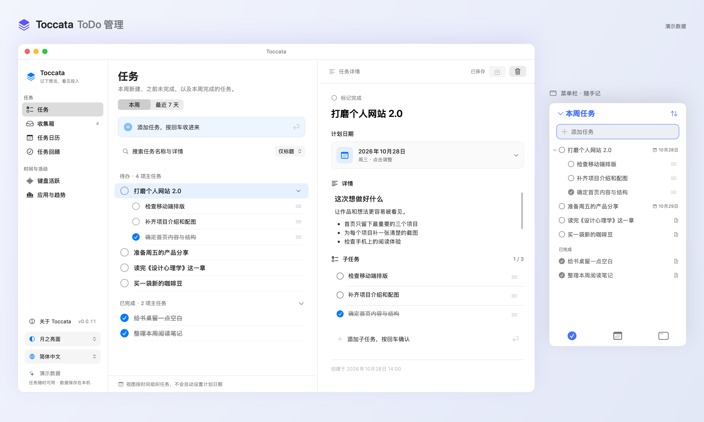
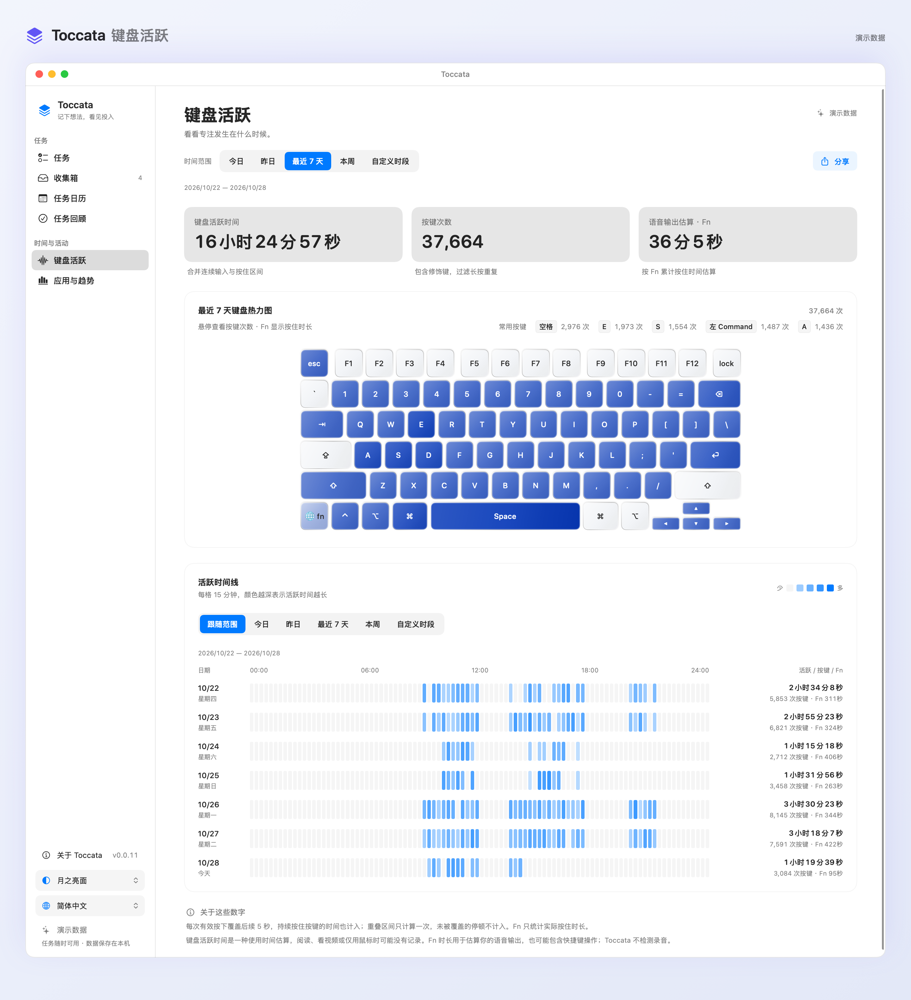
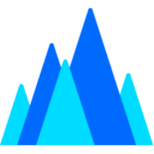
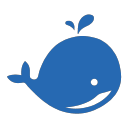

  

<h1 align="center">Toccata</h1>

  <strong>简体中文</strong> · <a href="README_EN.md">English</a>

  <strong>记下想法，看见投入</strong> 
  <em>想看下你的思维净活跃时长吗？</em>

  <a href="https://github.com/KMnO4-zx/Toccata/releases">下载安装</a> ·
  <a href="develop.md">开发指南</a> ·
  <a href="CONTRIBUTING.md">参与贡献</a> ·
  <a href="LICENSE">Apache-2.0</a>

## 起因

我以前从来不用 ToDo 应用，觉得事情放在脑子里完全 OK。最近工作、学习的事越来越多，终于还是得找个地方记下来。

需求很简单：随手打开就能看到已完成和未完成的任务，到了周末，把这周的事情拿出来写周报。于是试了滴答清单，做的太烂了，居然还想收我的钱！

**No way，那就自己做一个。**

我还很想做一个能记录 **「思维净活跃时长」** 的东西。每天在电脑前待那么久，到底有多少时间是我的思维活跃时间？既然都自己写了，那就把这个也一起做进去。

名字取自键盘乐曲 [Toccata](https://www.dictionary.com/browse/toccata)（托卡塔），源于意大利语 *toccare*，意为“触碰”。我喜欢这个联想：双手触键，想法慢慢变成眼前的东西。

## ToDo 管理

- **随手记**：菜单栏打开小窗，快速添加、编辑任务，完成与待办都能看到。
- **慢慢理**：主界面里拆分子任务，用 Markdown 写详情，按需安排日期、查看任务日历。
- **周末回顾**：汇总本周完成与尚未完成的事，一键复制为周报素材，再写自己的总结。

## 键盘活跃：思维净活跃时长

我还想知道一件事：用电脑的这些时间里，到底有多少是我本人在活跃。每隔几秒截一张图，再让 AI 分析我在干什么，这种方式隐私很难保证。所以我想从键盘输入入手。

我的想法很简单：**对电脑来说，我是在输入；对我自己来说，我是在输出。人在输出的时候，思维一定是活跃的。** 此时我和电脑的连接，就是双手十指之间的触碰。

> 回收伏笔：Toccata 源自意大利语 *toccare*，意为“触碰”。

我想用键盘记录自己在对外输出的时间，把它叫作 **「思维净活跃时长」**。这个概念在我看来很性感 🤔

- **按键热力图**：看看哪些键最常用，按下时也有实时反馈。
- **活跃时间线**：按天查看输入发生在哪些时段，也能回顾常用应用和 Fn 按住时长。
- **本机记录**：记录键码、时间、按住时长与应用归属，数据保存在本机，采集过程不截图、不录音。

> 「思维净活跃时长」是项目的创作概念，实际计时根据键盘活动估算，无法直接测量思维，也无法覆盖阅读、思考等全部投入。Fn 时长用于估算语音输出，也可能包含快捷键操作。详见[计算规则](develop.md#按键次数与活跃时间计算)。以上图片使用演示数据。

## 开始使用

适用于 **Apple Silicon Mac · macOS 13+**。从 [Releases](https://github.com/KMnO4-zx/Toccata/releases) 下载 DMG，将 `Toccata.app` 拖入“应用程序”即可安装。

键盘记录需要在“系统设置 → 隐私与安全性 → 输入监控”中授权；任务管理可以独立使用。

Toccata 常驻菜单栏，默认显示 Dock 图标，可在“设置 → 通用配置”中隐藏。点击菜单栏图标即可添加和管理任务；右键选择“打开工作台”查看完整界面。关闭工作台后继续在后台运行，选择“退出 Toccata”才会结束应用。

“设置 → 通用配置”集中提供外观、语言、喝水提醒、登录自启、Dock 图标和关于入口；左下角的外观、语言和关于入口继续保留。登录自启默认关闭。

在通用配置中，或右键菜单栏图标选择“喝水提醒…”，可开启按键计数提醒。默认每累计 8,192 次按键提醒一次，每天重新计数；可调整间隔、发送测试通知。首次开启需允许系统通知，按键计数沿用输入监控记录。关闭工作台后仍会提醒，退出应用后停止。

想按自己的习惯修改？构建与二次开发说明都在 [develop.md](develop.md)。

## 参与贡献

欢迎一起完善代码、文档、翻译和测试，参与方式见 [贡献指南](CONTRIBUTING.md)。Windows 版正在招募贡献者，欢迎到 [Windows 版本支持 #1](https://github.com/KMnO4-zx/Toccata/issues/1) 交流方案、认领功能；独立开发目录为 [apps/toccata-windows/](apps/toccata-windows/README.md)。

## 致谢 🙏

-  &nbsp; 感谢 **[Kimi 全球大使计划](https://www.kimi.com/zh-cn/lp/kimi-ambassador)**。 Kimi K3.1 Pro 是一个在审美设计领域很棒的模型！
-  &nbsp; 感谢 **[OpenAI Codex For Open Source 计划](https://developers.openai.com/community/codex-for-oss)**，赠予我 12 个月的 ChatGPT Pro 订阅。GPT 6 Astra 是一个很棒的 Coding 模型！
-  &nbsp; 感谢 **[火山 Hero 计划](https://developer.volcengine.com/)**。 豆包的多模态能力确实非常棒！
-  &nbsp; 感谢 **[Datawhale](https://datawhale.cn/)**。 在 Datawhale 可以遇到优秀的同行人。
